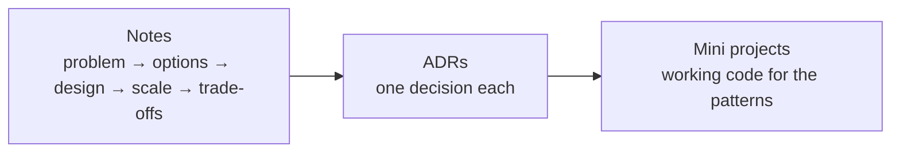

# architecture-notes

[](https://github.com/SaurabhTiwari95/architecture-notes/actions/workflows/ci.yml)

Architecture write-ups and decision records: how to let AI agents work safely on a system you
can't change, how to stop one tenant's outage taking everyone down, how to upgrade a production
database engine without drama, and how to move file uploads off your app servers.

Each note covers the problem, the options considered, the design (with a diagram), how it
scales, and the trade-offs. Each decision also has a short
[Architecture Decision Record](adr/README.md).



## Contents

| # | Note | Decisions |
|---|---|---|
| 01 | [Letting AI agents work on a system you can't change](notes/01-ai-agents-on-an-existing-system.md) | [0001](adr/0001-gateway-instead-of-direct-db-access.md), [0002](adr/0002-hmac-with-nonce-instead-of-static-api-keys.md), [0003](adr/0003-validate-then-commit-for-agent-writes.md) |
| 02 | [One tenant's outage shouldn't stop the others](notes/02-multi-tenant-fault-isolation.md) | [0005](adr/0005-database-per-tenant.md) |
| 03 | [Database engine upgrade playbook (managed MySQL)](notes/03-database-engine-upgrade-playbook.md) | [0006](adr/0006-blue-green-for-engine-upgrades.md) |
| 04 | [Uploading files straight to S3 with pre-signed requests](notes/04-direct-to-s3-uploads.md) | [0004](adr/0004-pre-signed-direct-uploads.md) |

## How to read it

- **On GitHub:** just open the notes. Diagrams are Mermaid and render on GitHub by themselves.
- **On your computer:** clone it (below) and open the folder in VS Code. Press `Ctrl+Shift+V`
  (macOS: `Cmd+Shift+V`) on a note for the preview. For diagrams in the preview, install the
  extension **Markdown Preview Mermaid Support**.

## Prerequisites

Only needed to run the checks or contribute:

| Tool | Version | Get it |
|---|---|---|
| Git | any recent | <https://git-scm.com/downloads> |
| Python | 3.12 | <https://www.python.org/downloads/> |
| gitleaks (optional, for local secret scans) | 8.x | <https://github.com/gitleaks/gitleaks#installing> |

## Install

### Windows (PowerShell)

```powershell
git clone https://github.com/SaurabhTiwari95/architecture-notes.git
cd architecture-notes
py -3.12 -m venv .venv
.\.venv\Scripts\Activate.ps1
pip install -r requirements-dev.txt
```

### macOS / Linux

```bash
git clone https://github.com/SaurabhTiwari95/architecture-notes.git
cd architecture-notes
python3.12 -m venv .venv
source .venv/bin/activate
pip install -r requirements-dev.txt
```

## Run the checks

```bash
python scripts/prepublish_check.py
```

Expected output when clean:

```text
prepublish-check: 0 hit(s), 5 blocked word(s) checked.
```

A hit looks like this, and the exit code is 1:

```text
notes/02-multi-tenant-fault-isolation.md:14  ipv4-address
prepublish-check: 1 hit(s), 5 blocked word(s) checked.
```

Tests, lint and a local secret scan:

```bash
pytest
ruff check . && ruff format --check .
gitleaks detect --source . --verbose
```

`pytest` prints a coverage table and fails under 80%.

## Configuration

The pre-publish check refuses to run without a private block-list: the names you never want
published (employers, products, people, internal domains). **The list is never stored in the
repo.**

| Variable | Purpose | Default | Required |
|---|---|---|---|
| `BLOCKED_WORDS` | Comma- or newline-separated words to block. Used in CI from a repository secret | empty | One of the two |
| `BLOCKED_WORDS_FILE` | Path to a file with one word per line (`#` for comments) | `~/.prepublish/blocked-words.txt` | One of the two |

Set it up once:

1. Create the file `~/.prepublish/blocked-words.txt` (Windows: `C:\Users\<you>\.prepublish\blocked-words.txt`),
   one word per line.
2. On GitHub: **Settings → Secrets and variables → Actions → New repository secret**, name
   `BLOCKED_WORDS`, value the same words separated by commas.

Hits from the block-list print as `blocked-word #N`, never the word, so public CI logs stay clean.
A line with a deliberate fake sample (for tests) can carry `prepublish-ignore`; that skips the
pattern rules on that line only, never the block-list.

## Troubleshooting

| Problem | Fix |
|---|---|
| `No block-list found` (exit code 2) | Create `~/.prepublish/blocked-words.txt` or set `BLOCKED_WORDS` (see Configuration) |
| CI fails at the pre-publish step on a fork's pull request | Secrets aren't passed to forks; re-run it from a branch in this repo |
| `Activate.ps1 cannot be loaded because running scripts is disabled` | Run `Set-ExecutionPolicy -Scope CurrentUser RemoteSigned` once, then activate again |
| `py` or `python3.12` not found | Install Python 3.12 and tick **Add python.exe to PATH**, then open a new terminal |
| Mermaid diagrams show as code in VS Code | Install **Markdown Preview Mermaid Support** |

## Design decisions

- **Notes plus ADRs:** notes explain the whole design; ADRs record one decision each so they can be
  superseded without rewriting the notes.
- **Mermaid, not images:** diagrams are text, so they're versioned, diffable and render on GitHub.
- **Numbers are illustrative:** cost examples use made-up round figures and say so. Check current
  provider pricing.
- **Pre-publish check in CI:** a design-notes repo is where internal details slip in most easily,
  so every push is scanned for private names, IPs, emails, phone numbers and keys.

## How it scales

This is documentation, so "scale" means growth in content and readers:

- New notes take the next number; new decisions take the next ADR number. Nothing is renumbered.
- Superseded ADRs stay, marked "Superseded by NNNN", so the history of a decision is kept.
- The checks scan the whole repo in well under a second at this size; they read files once and
  skip anything over 2 MB, so they stay fast as the repo grows.

## What's next

- Note 05: cost caps and model choice for LLM agents.
- Note 06: human-in-the-loop approval flows.
- Each note gets a link to its working mini project once that project is published.

---

AI-assisted (Claude Code); design and review by me.

Licence: [MIT](LICENSE). Security: [SECURITY.md](SECURITY.md).
