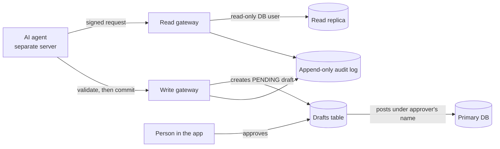

# 01. Letting AI agents work on a system you can't change

## The problem

A business runs on an existing application: years of code, a large relational database, many
daily users. You want AI agents to **read** its data (answer questions, check requirements,
build reports) and, in a few narrow cases, **write** to it (draft an invoice, raise a request).

Constraints that usually come with it:

- The application's code can't be changed safely or quickly. Any regression hits real users.
- The agent runs on a different server and is not trusted the way an employee is.
- Every write must still have a human who is accountable for it.
- Cost has to stay predictable: agents can loop, retry and call models far more than people do.

## Options considered

| Option | Why it's tempting | Why it was rejected or kept |
|---|---|---|
| Give the agent database credentials | Fastest; full access to everything | Rejected. No allow-list, no audit trail, one bad query can lock tables or leak everything |
| Add agent endpoints inside the application | Reuses the app's business rules | Rejected. Changes the system we promised not to touch; every release now carries agent risk |
| **A separate gateway in front of the data** | Agent gets only what is listed, through one audited door | **Kept.** The application stays untouched; access rules live in one small, testable service |

## The design

**Read path.** The agent calls named functions such as `list_overdue_invoices`, never raw SQL.
The gateway checks, in order:

1. The caller's IP is on an allow-list.
2. The request is signed (HMAC-SHA256 over method, path, timestamp, nonce and body).
3. The timestamp is fresh (for example within 5 minutes) and the nonce has never been seen.
4. The function is on the allow-list, stored as data so it can change without a deploy.
5. The function is read-only: a check at start-up refuses to load anything able to write, send
   mail or run a shell.

It then runs the function as a database user that has only `SELECT` rights, preferably on a
read replica, so agent load never competes with users on the primary.

**Write path.** Writes never go straight in:

1. `validate`: the agent sends the draft; the gateway checks it and returns a preview and a
   short-lived token.
2. `commit`: the agent sends the token with an `Idempotency-Key`; the gateway stores a **PENDING
   draft**, not a real record.
3. A person approves the draft in the normal application. Only then does it post, **under the
   approver's name**, inside per-record limits (amount ceiling, expiry).

Daily caps, an allowed-hours window and a circuit breaker sit on top, so a misbehaving agent
stops itself before it does damage.

## Controls at a glance

| Risk | Control |
|---|---|
| Stolen or replayed request | HMAC signature, timestamp window, single-use nonce, IP allow-list |
| Agent reads more than it should | Function allow-list; read-only DB user; row limits and pagination |
| Agent writes something wrong | Validate-then-commit, human approval, per-record limits, expiry |
| Duplicate writes on retry | Idempotency keys stored with the first result |
| Runaway loop | Daily caps, hours window, circuit breaker, model spend caps |
| "Who did this?" | Append-only audit log; records post under the approving person |

## How it scales

- The gateway is stateless; nonces and caps live in Redis or the database, so more instances can
  sit behind a load balancer.
- Reads go to replicas; add replicas as agent read load grows.
- What breaks first at 10×: the nonce store's write rate. Fix: Redis with a TTL per nonce.
- At 100×: the audit log table. Fix: partition by month and ship old partitions to cheap storage.

## Trade-offs

- Every new agent capability needs a new allow-listed function: slower than raw SQL, on purpose.
- Human approval adds delay to writes. That's accepted: the agent saves the typing, the person
  keeps the responsibility.
- The gateway duplicates some validation the application already has. It's kept small and tested
  heavily to make that acceptable.

Related decisions: [ADR 0001](../adr/0001-gateway-instead-of-direct-db-access.md),
[ADR 0002](../adr/0002-hmac-with-nonce-instead-of-static-api-keys.md),
[ADR 0003](../adr/0003-validate-then-commit-for-agent-writes.md).
