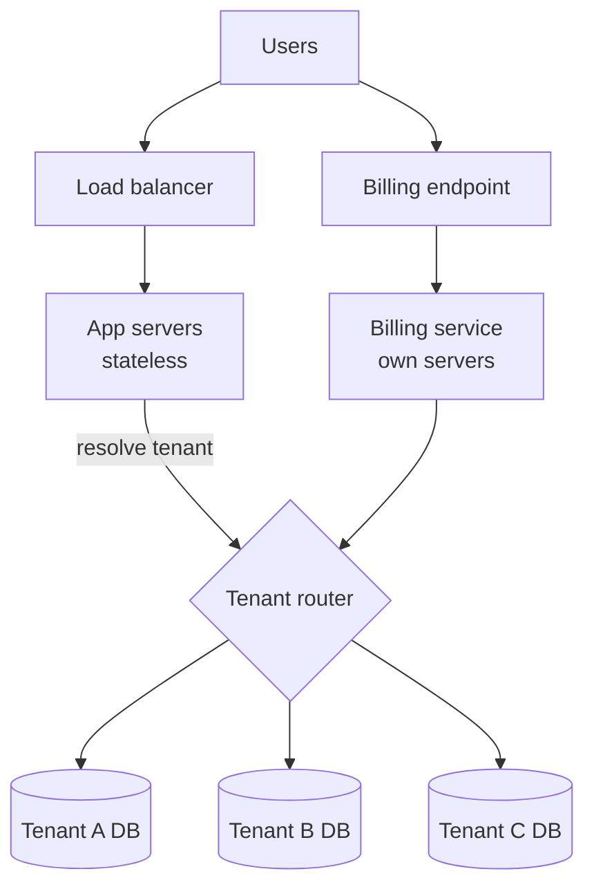

# 02. One tenant's outage shouldn't stop the others

## The problem

One application serves several companies (tenants). It started as one server and one database
for everyone. Then one tenant ran a heavy month-end report, the database CPU hit 100%, and every
company was down at once. Billing, the one thing that must never stop, stopped too.

## Options considered

| Model | Isolation | Cost and effort | Verdict |
|---|---|---|---|
| Shared app, shared DB, `tenant_id` column | Lowest: one noisy tenant hurts all | Cheapest | Where most systems start |
| Shared app, **database per tenant** | Data and load isolated | Moderate; migrations run per DB | **Chosen** |
| Fully separate stack per tenant ("cells") | Highest | Most expensive; ops per cell | Kept for the future, for very large tenants |

## The design

1. **Route by tenant.** Each request carries a tenant id (from the session, never from user
   input alone). A small router maps tenant to connection settings, cached in memory with a
   short expiry.
2. **Database per tenant.** A slow query or a failed instance affects one company only.
3. **Separate billing path.** Billing runs on its own servers with its own connection pool, so
   an outage in the main app doesn't stop invoices.
4. **Bulkheads in the app.** One connection pool per tenant with a hard maximum, so one tenant
   can't take every connection.
5. **Timeouts and circuit breakers** on every call to a tenant DB. When a tenant's DB is down, the
   app shows a clear "Company X is temporarily unavailable" page and the others carry on.

## Running it

- **Migrations:** one migration set, run against each tenant DB in turn by a job that stops at
  the first failure and reports which tenants are on which version.
- **Monitoring:** every metric (latency, errors, connections) is tagged by tenant, so "is it
  everyone or just one company?" is answered in seconds.
- **Backups:** per tenant, so one company can be restored without rolling back the others.

## How it scales

- New tenant: create a DB from a template, add a router entry. No code change.
- At 10× tenants: per-DB overhead grows. Fix: group small tenants on shared instances (still
  separate schemas) and give large ones their own.
- At 100×: move to cells, so a group of tenants gets its own full stack and a failure stays inside
  one cell.

## Trade-offs

- Cross-tenant reports need a separate reporting store fed by each tenant's DB.
- Migrations take longer and can leave tenants briefly on different versions; the code must handle
  both during a rollout.

Related decision: [ADR 0005](../adr/0005-database-per-tenant.md).
