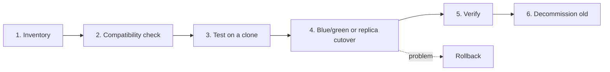

# 03. Database engine upgrade playbook (managed MySQL)

## Why upgrade at all

Managed database services support each major engine version for a fixed period. After standard
support ends, you either upgrade or pay an **extended support** fee, usually charged per vCPU per
hour on top of the normal instance price. For a fleet of instances this quietly becomes one of
the largest lines on the bill.

### A simple cost model

```text
monthly extended-support cost = sum over instances of (vCPUs × hours in month × rate per vCPU-hour)
                                  × 2 if Multi-AZ (the standby is billed too)
```

Example with **illustrative numbers only** (check your provider's current pricing page):
3 instances × 4 vCPUs × 730 hours × $0.10 = **$876 a month**, or about **$10,500 a year**,
for running the same databases you already pay for. That's usually enough to justify the
upgrade work by itself.

## The playbook



### 1. Inventory

For every instance: engine version, size, Multi-AZ or not, parameter group, which applications
connect to it, and a quiet window for the cutover.

### 2. Compatibility check (MySQL 5.7 to 8.0 examples)

- **New reserved words** (for example `RANK`, `GROUPS`, `LEAD`, `WINDOW`) used as table or
  column names must be quoted or renamed.
- **Default authentication** changes to `caching_sha2_password`; older client libraries may
  fail to connect. Upgrade the drivers or set the user's plugin explicitly.
- **Default character set** becomes `utf8mb4`, with a new default collation; compare string
  sorting and check index length limits.
- **Implicit `GROUP BY` sorting is gone:** queries that relied on it need an explicit `ORDER BY`.
- **Query cache is removed:** remove the settings and any code that depended on it.
- **Stricter SQL modes:** run the application's queries with the new modes in test first.
- Run the vendor's upgrade checker utility and fix everything it reports.

### 3. Test on a clone

Restore the latest snapshot to a new instance, upgrade it, point a test copy of the application at
it and run the full regression suite plus the ten heaviest real queries. Compare timings
before and after.

### 4. Cutover

Prefer a **blue/green deployment** (the managed service keeps an upgraded copy in sync and
switches over in about a minute) or an upgraded read replica that you promote. Both keep the old
instance untouched as a rollback path. Announce the window, freeze schema changes, switch over.

### 5. Verify

Connections, error rates, slow-query log, replication lag, and a business smoke test (log in,
create a record, run a report) per application.

### 6. Decommission

Keep the old instance stopped (or a final snapshot) for an agreed period, then delete it. Confirm
on the next bill that the extended-support line has gone.

## Rollback

If verification fails inside the window, switch back to the old (blue) instance. Writes made
after the switch must be reconciled, which is why the window is short and announced.

## Trade-offs

- Blue/green doubles the instance cost for the days it runs. Cheap compared with the risk.
- Upgrading everything at once is faster; upgrading the least critical instance first finds
  surprises cheaply. The second is the recommended order.

Related decision: [ADR 0006](../adr/0006-blue-green-for-engine-upgrades.md).
