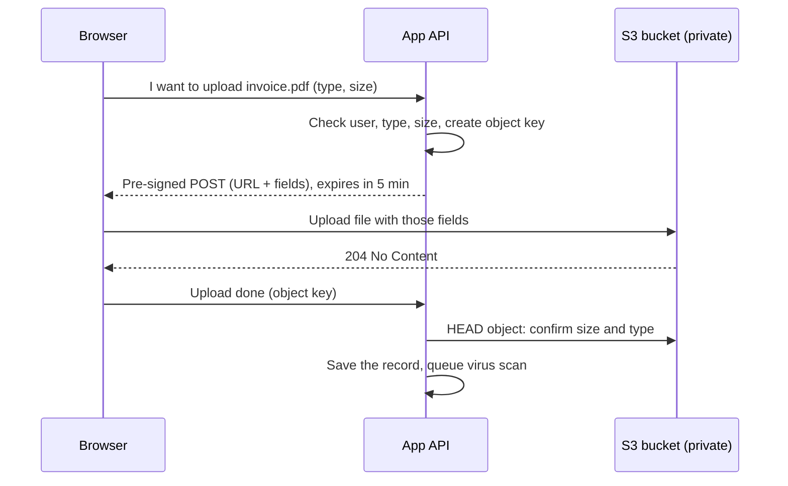

# 04. Uploading files straight to S3 with pre-signed requests

## The problem

Users upload documents (PDFs, images) through the web app. Uploading through the application
server means every byte passes through it: large files tie up workers, memory spikes, and the
server pays twice for bandwidth (in, then out to storage).

## The design

The browser uploads **directly to the storage bucket**, using a short-lived, narrowly scoped
permission that the application hands out.

## Rules that make it safe

- **The server picks the object key** (for example `uploads/{tenant}/{yyyy}/{mm}/{uuid}.pdf`).
  The user's file name is stored as data, never used as the path.
- **Pre-signed POST rather than PUT when size matters:** a POST policy can enforce
  `content-length-range` and an exact `Content-Type`, so the bucket itself rejects a 2 GB file
  claiming to be a 2 MB PDF.
- **Short expiry** (minutes, not hours).
- **The bucket stays private:** Block Public Access on; downloads are pre-signed GET URLs too.
- **Least-privilege role:** the API's role may only `s3:PutObject` and `s3:GetObject` on the
  `uploads/` prefix, nothing else.
- **CORS on the bucket** allows only the app's own origin, and only the methods needed.
- **Verify after upload:** check the object's real size and type before saving the record; scan
  for malware asynchronously and quarantine on failure.
- **Encryption at rest** with the bucket's default key.

## Cost and housekeeping

- A lifecycle rule **aborts incomplete multipart uploads** after a day; otherwise abandoned parts
  are billed forever.
- Old files move to a cheaper storage class after an agreed period.
- Files never pass through the app server, so app instances can stay small.

## How it scales

- The API only signs requests (milliseconds of CPU), so upload volume barely touches it.
- Storage scales by itself; very large files use multipart upload with a pre-signed URL per part.
- At high request rates, spread keys across prefixes (the date and UUID in the key already do).

## Trade-offs

- Two round trips instead of one, and a little more frontend code (progress bar, retry).
- The app must handle uploads that were signed but never finished (a cleanup job, or the
  lifecycle rule above).

Related decision: [ADR 0004](../adr/0004-pre-signed-direct-uploads.md).
